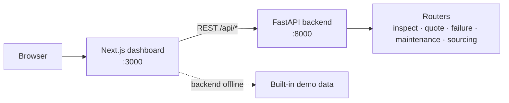

<div align="center">

# BearingAI — Bearing Manufacturing Platform

A prototype dashboard and API for bearing manufacturers covering visual inspection,
quotation, failure analysis, predictive maintenance and sourcing intelligence.


</div>

> **Prototype status.** The backend returns **simulated data** so the full user experience
> can be demonstrated without trained models. Each router is a clean seam where a real model
> or data source can be plugged in. See [Extending the platform](#extending-the-platform).

## Table of contents

- [Modules](#modules)
- [Architecture](#architecture)
- [Getting started](#getting-started)
- [API reference](#api-reference)
- [Project structure](#project-structure)
- [Demo mode](#demo-mode)
- [Extending the platform](#extending-the-platform)
- [License](#license)

## Modules

| Module                 | What it does                                                    |
| ---------------------- | --------------------------------------------------------------- |
| Visual inspection      | Upload a bearing image and get a defect report plus statistics  |
| Quotation              | Generate price quotes and review quote history                  |
| Failure analysis       | Diagnose likely failure causes and browse known failure patterns |
| Predictive maintenance | Machine health scores and active alerts                         |
| Sourcing intelligence  | Demand forecast, supplier scoring and a sourcing recommendation |

## Architecture



More detail is in [docs/architecture.md](docs/architecture.md).

## Getting started

**Prerequisites:** Python 3.11+ and Node.js 20+.

### 1. Backend

```bash
cd backend
python -m venv .venv
source .venv/bin/activate        # Windows: .venv\Scripts\activate
pip install -r requirements.txt
cp .env.example .env
uvicorn main:app --reload --port 8000
```

Interactive API docs: <http://localhost:8000/docs>

### 2. Frontend

```bash
cd frontend
npm install
cp .env.example .env.local
npm run dev                      # http://localhost:3000
```

### Configuration

| Variable              | Location        | Purpose                           |
| --------------------- | --------------- | --------------------------------- |
| `NEXT_PUBLIC_API_URL` | `frontend/.env.local` | Backend base URL (default `http://localhost:8000`) |
| `ANTHROPIC_API_KEY`   | `backend/.env`  | Reserved for AI-backed analysis; not required by the simulated routers |
| `PORT`, `ENV`         | `backend/.env`  | Server settings                   |

## API reference

| Method | Endpoint                   | Description                  |
| ------ | -------------------------- | ---------------------------- |
| POST   | `/api/inspect`             | Analyse a bearing image      |
| GET    | `/api/inspect/stats`       | Inspection statistics        |
| POST   | `/api/quote`               | Create a quotation           |
| GET    | `/api/quote/history`       | Quotation history            |
| POST   | `/api/failure/analyze`     | Failure analysis             |
| GET    | `/api/failure/patterns`    | Known failure patterns       |
| GET    | `/api/maintenance/machines`| Machine health               |
| GET    | `/api/maintenance/alerts`  | Maintenance alerts           |
| GET    | `/api/sourcing/forecast`   | Demand forecast              |
| GET    | `/api/sourcing/suppliers`  | Supplier scores              |
| GET    | `/api/sourcing/recommendation` | Sourcing recommendation  |

## Project structure

```
bearing-ai-platform/
├── backend/
│   ├── main.py                  FastAPI app, CORS and router registration
│   ├── routers/
│   │   ├── inspection.py        /api/inspect
│   │   ├── quotation.py         /api/quote
│   │   ├── failure.py           /api/failure
│   │   ├── maintenance.py       /api/maintenance
│   │   └── sourcing.py          /api/sourcing
│   ├── requirements.txt
│   └── .env.example
├── frontend/
│   ├── src/
│   │   ├── app/                 One route per module
│   │   ├── components/          Sidebar, StatCard, StatusBadge, DemoBanner
│   │   └── lib/                 API client and demo data
│   ├── package.json
│   └── .env.example
├── docs/
│   └── architecture.md
├── LICENSE
└── README.md
```

## Demo mode

If the backend cannot be reached, the frontend falls back to built-in sample data and
shows a **Demo Mode** banner, so the dashboard can be explored with only
`npm run dev`.

## Extending the platform

1. Pick a router in `backend/routers/`, for example `inspection.py`.
2. Replace the simulated logic in the endpoint with a model call, database query or
   external API. Keep the Pydantic response model so the frontend does not change.
3. Add tests and, if needed, new fields to the response model and the matching
   TypeScript types.

## License

Released under the [MIT License](LICENSE).

---

Built by **Swagata Banerjee** · [GitHub](https://github.com/gitswagata1)
